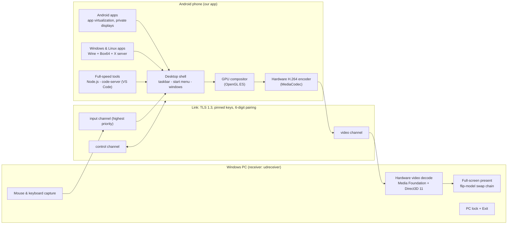

# unified-desktop

**Your Android phone is the computer. Any PC is just the screen, keyboard and mouse.**

Connect an Android phone to any Windows PC, by USB cable or over Wi-Fi, and the PC becomes a
full-screen desktop that runs **Windows apps, Linux apps, Android apps and full-speed developer
tools such as VS Code**, all executing on the phone. The phone stays fully usable the whole
time. One **Exit** button gives the PC back, exactly as it was.

> `unified-desktop` is a working codename.

---

## Why

Billions of people own a powerful phone, but not a powerful computer. Students, freelancers and
people in shared spaces (labs, libraries, offices, cyber cafes) often sit at a PC that is old,
shared or locked down. This project flips the model:

- **The phone does all the work.** Every app runs on the phone's CPU and memory.
- **The PC is only a display and keyboard.** Nothing of yours is installed or left on it.
- **Your desktop travels with you.** Plug into any PC and continue where you stopped.

## What it does

| Capability | What the user gets |
|---|---|
| **Run Windows programs** | `.exe` applications (for example Notepad++) run through Wine on an x86-to-ARM translator, in a normal desktop window. |
| **Run Linux programs** | x86-64 Linux GUI programs run through the same translator, with no virtual machine. |
| **Run Android apps on the PC** | Apps installed from Google Play run *hidden* inside our app and appear as windows on the PC, not on the phone's screen. |
| **Full-speed developer tools** | VS Code (code-server on Node.js) and its terminal ship as native ARM code inside the app and run at full phone speed; more tools (Python, Git) use the same model. |
| **A real desktop** | Taskbar, start menu, movable and resizable windows, Files, a built-in browser and Settings, driven by the PC's mouse and keyboard. |
| **USB or Wi-Fi** | A cable is used when present (faster, and it charges the phone); Wi-Fi on the same network otherwise, found automatically. |
| **Secure pairing** | A 6-digit code shown on both sides; after one confirmation the PC is trusted and reconnects silently. All traffic is encrypted. |
| **PC lock with one Exit** | While connected, the receiver is full screen and the rest of the PC is out of reach, like exam software. One Exit button ends it. |
| **The phone stays usable** | Calls, WhatsApp, the camera: the phone keeps working normally during a session. |
| **App Center** | Install apps by name. It picks the version that runs best on a phone: a built-in full-speed version, the Android version, a web version, the Linux version, then the Windows version. |

## Principles (non-negotiable)

- **No developer mode, no root, no ADB** for the user, at any step.
- **Installable from Google Play.** Only code shipped inside the APK runs as native code;
  everything downloaded later runs as data through a translator or an interpreter we ship.
- **No virtual machine** and no "booting Linux". Apps start directly.
- **The phone stays fully usable** while connected. Only the PC is locked.
- **One Exit button**, no password, and the PC is back to normal at once.

---

## How it works



### On the phone

| Part | How |
|---|---|
| **Desktop surface** | A private virtual display owned by our app hosts the desktop shell. Its frames go straight from the GPU into the hardware video encoder, with no CPU copies. |
| **Compositor + encoder** | An OpenGL ES compositor draws the desktop into the input surface of the hardware H.264 encoder (low-latency mode, no B-frames, keyframes on demand). It draws only when something changes, paces itself to what the encoder can take, and sends a keep-alive frame once a second when the screen is still. |
| **Desktop shell** | Our own window manager: z-order, focus, move/resize/minimize/maximize/close, taskbar, start menu. Each window can host native views, a web view, another app's display, or an X11 screen. |
| **Android apps** | An app-virtualization engine (the open-source BlackBox family) runs apps installed from Google Play inside our process; each app draws on its own private virtual display, owned by us. |
| **Windows & Linux apps** | Box64 translates x86-64 code to ARM64 on the fly. It runs an X server (Xvfb) and Wine as data, and the X screen is shown inside a desktop window. Mouse and keyboard go in through XTEST. |
| **Full-speed tools** | Node.js, code-server (VS Code) and their native libraries ship inside the APK as `lib*.so` files, so they run at full ARM speed within Google Play's rules. VS Code is served on `127.0.0.1` only, with a random password, and shown in a built-in web view window. |
| **Input** | PC mouse and keyboard events are delivered to our own views (no Accessibility service, no special permissions). Typing into web pages uses the web view's own text-input connection, the way a phone keyboard does. Key and button presses are never dropped, and every held key is released if the PC window loses focus. |
| **Session service** | A foreground service owns the link while a PC is connected, so Android does not freeze or kill the session. |

### The link

| Part | How |
|---|---|
| **Transport** | One TCP connection secured with **TLS 1.3**. Both sides hold self-signed keys; after pairing, each side **pins** the other's certificate. |
| **Pairing** | The PC and the phone each show a **6-digit code** derived from both certificates. The user confirms on the phone that the codes match. A different PC can never connect silently. |
| **Discovery** | The phone advertises itself on the local network over **mDNS** (`_udlink._tcp`), so the PC finds it with no IP address typed in. |
| **USB** | USB tethering (a normal Android setting, with built-in Windows drivers), plus Android Open Accessory as the driver-level USB path. Neither needs USB debugging. |
| **Framing** | Small framed messages on separate channels: **input > control > video**. A big video frame is cut into 64 KiB chunks, so a key press is never stuck behind it. |
| **Keep-alive** | Heartbeats every 5 seconds; a link silent for 15 seconds is closed on both sides, and the session can continue on the other link. |

Full wire format: [docs/PHASE4_PROTOCOL.md](docs/PHASE4_PROTOCOL.md).

### On the PC

The receiver (`udreceiver`) is a small native Windows program written in Rust:

- **Hardware video decode:** Media Foundation's H.264 decoder on a Direct3D 11 device (DXVA), low-latency mode.
- **Immediate present:** NV12-to-RGB conversion on the GPU with no extra buffering.
- **Input capture:** mouse, wheel and keyboard with scan codes, mapped to desktop coordinates.
- **Pairing and trust store:** remembers confirmed phones.
- **Lock (design):** a full-screen session on its own desktop, with a low-level keyboard hook in the style of exam-lockdown software, and one Exit button.

---

## The experience

1. **Install once.** The app on the phone from Google Play; the small receiver on the PC.
2. **Pair once.** Connect by cable or Wi-Fi. Both screens show the same 6-digit code; tap **Yes** on the phone.
3. **Every day.** Plug in, or just be on the same Wi-Fi. The PC goes full screen with your desktop.
4. **Work.** Windows, Linux and Android apps and VS Code side by side, with the PC's mouse and keyboard, while your phone keeps working normally.
5. **Exit.** One click and the PC is back to normal. Your apps stay open on the phone for next time.

Step by step from the user's side: [USER_WORKFLOW.md](USER_WORKFLOW.md).

## Design targets

| Measure | Target |
|---|---|
| Connect to a usable desktop | 5 s or less |
| Typing latency, key on the PC to visible on the PC (USB) | 80 ms or less |
| Typing latency over 5 GHz Wi-Fi | 120 ms or less |
| Frame rate while moving windows | 30 fps or more |
| A light Windows app (Notepad++) starts | 10 s or less |
| VS Code opens a small project | 15 s or less |
| Session on charger without being killed | 2 hours |
| Receiver on an old PC (dual-core, 4 GB RAM, Windows 10) | 1080p full screen |

Reference phone: a mid-range Snapdragon 695 device, so the numbers hold on most phones.

---

## Tech stack

| Area | Technology |
|---|---|
| Phone app | Kotlin, Android SDK (targetSdk 36, minSdk 29), Android NDK |
| Video | MediaCodec hardware H.264 encoder, OpenGL ES compositor, private `VirtualDisplay` |
| Android apps | BlackBox-family app-virtualization engine (Apache-2.0) |
| Windows apps | Wine (LGPL) on Box64 (MIT, x86-64 to ARM64 dynamic recompiler) |
| Linux apps | Box64 + pinned x86-64 Debian packages; Xvfb X server |
| Developer tools | Node.js 24 and code-server (VS Code, MIT) built for Android, Open VSX extensions |
| Built-in browser | Android System WebView (Chromium) |
| Link | TLS 1.3 (Conscrypt on Android, rustls on the PC), mDNS/NSD discovery, custom framed protocol |
| PC receiver | Rust; `windows` crate (Win32, Media Foundation, Direct3D 11, WinUSB); rustls, ring, rcgen |
| Build | Gradle 9.8 with Android Gradle Plugin 9.4, Cargo |

Why each choice was made: [TECH_STACK.md](TECH_STACK.md) and [DECISIONS.md](DECISIONS.md).

---

## Repository layout

```
android/                 the phone app (Gradle project)
  app/                   the app: desktop shell, video pipeline, link service, engines
  engine/                fetch + patch script for the app-virtualization engine source
  vscode/                fetch script for the full-speed tools (Node.js, code-server natives)
  win86/                 build script for Box64 and the Windows/Linux runtime glue
pc/
  udreceiver/            the Windows receiver (Rust): link, pairing, discovery, video, input
docs/                    protocol specification and engineering write-ups
PRD.md                   what the product must do
USER_WORKFLOW.md         what the user does and sees
ARCHITECTURE.md          how it works inside
ALGORITHMS.md            the key methods (frame pipeline, input path, pairing, failover)
OPTIMIZATION.md          how it stays fast on a cheap phone and light on an old PC
TECH_STACK.md            technologies and why
DECISIONS.md             settled design choices
THIRD_PARTY.md           every third-party component, its version and license
```

## Building from source

Third-party binaries are never committed. Each one is fetched by a script with a pinned
version and a SHA-256 check.

### Phone app

Requirements: JDK 17, Android SDK platform 36 (build-tools 36.0.0), NDK 26.1.10909125, a Linux
shell (or WSL) for the fetch scripts.

```sh
# 1. App-virtualization engine source (pinned commit, patches applied)
android/engine/fetch-source.sh

# 2. Full-speed tools: Node.js / code-server native libraries -> app/src/main/jniLibs/<abi>/
android/vscode/fetch-native.sh

# 3. Box64 for arm64 -> app/src/main/jniLibs/arm64-v8a/libbox64.so (needs NDK r27c on Linux)
android/win86/fetch-box64.sh

# 4. Build, test and lint
cd android
./gradlew :app:testDebugUnitTest :app:lintDebug :app:assembleDebug
```

`gradlew` downloads Gradle 9.8.1 and verifies its SHA-256. Wine, the x86-64 Linux packages and
the code-server JavaScript are downloaded by the app at runtime, each pinned and SHA-256 checked.

### PC receiver

Requirements: Windows 10/11, Rust (stable), Visual Studio Build Tools with the Windows SDK.

```sh
cd pc
cargo build --release
cargo test --release
```

The binary is `pc/target/release/udreceiver.exe`.

### Running a session

1. Install the app on the phone and open it. Allow notifications and tap **Start link**.
2. On the PC:

```sh
udreceiver discover                 # find the phone on the local network (mDNS)
udreceiver pair --addr auto         # first time: compare the 6-digit code, tap Yes on the phone
udreceiver view --addr auto         # full-screen desktop; Esc quits, F11 toggles windowed
udreceiver bench --addr auto        # link throughput and round-trip latency
udreceiver trust list               # trusted phones; `trust forget <id>` removes one
```

---

## Security and privacy

- **Encrypted end to end.** Every byte between phone and PC goes over TLS 1.3.
- **Explicit trust.** A PC is trusted only after the user confirms matching 6-digit codes on the phone. Trusted keys are pinned, so an impostor cannot reuse a name or address.
- **Local only.** No cloud relay and no account. The phone and the PC talk directly.
- **Nothing left on the PC.** The PC only shows pictures and sends keystrokes. Your apps and files stay on the phone.
- **Minimal permissions.** No Accessibility service, no root, no developer mode, no special system permissions.
- **Local tools stay local.** VS Code's server listens on `127.0.0.1` only, with a random password per session.

## Known limits

- A Google Play app cannot replace the phone's operating system. "The desktop" is our own environment, shown full screen on the PC.
- A virtualized Android app keeps its own login: the user signs in once inside it. Some apps (typically banking) refuse to run as copies.
- Android apps must come from Google Play, not from random APK files.
- Not every Windows program runs under Wine. App Center rates apps so users know before installing.
- Heavy 3D games will not be smooth on a low-end phone.
- Windows reserves Ctrl+Alt+Del. Its menu can be hidden, as exam software does, but the key itself cannot be blocked.

## Third-party software

This project builds on excellent open-source work, including Box64, Wine, the BlackBox
app-virtualization engine, Node.js, code-server, Xvfb and the X.org libraries, rustls, ring and
the Rust `windows` crate. Every component, its exact version or commit, its license and its
source are listed in [THIRD_PARTY.md](THIRD_PARTY.md).
